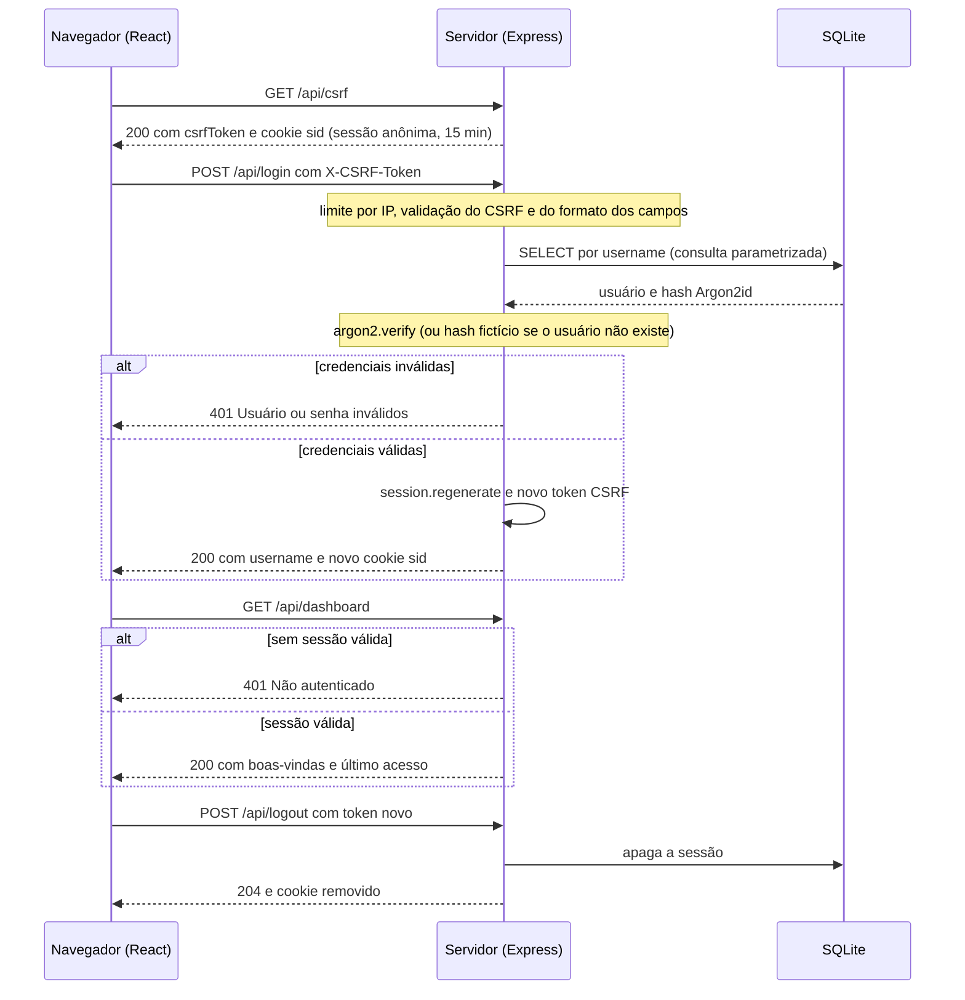

# Projeto Aplicado: Secure by Design

--**Autor:** José Willames de Almeida Barbosa
--**Instituição e disciplina:** Universidade Estadual de Ciências da Saúde de Alagoas, Projeto Aplicado: Práticas de Mercado
--**Repositório:** https://github.com/willamesalmeida/projeto-aplicado
--**Aplicação em produção:** https://129.148.51.134

Aplicação web desenvolvida com a filosofia **Secure by Design**, demonstrando controles e mitigações rigorosas alinhadas ao **OWASP Top 10:2025**.

Este README é o relatório técnico da entrega. As imagens de prova estão em [docs/EVIDENCIAS.md](docs/EVIDENCIAS.md).

## Como Rodar Localmente

Siga a sequência de passos abaixo para configurar e executar a aplicação no seu ambiente de desenvolvimento:

1. **Entrar na pasta `app`:**
   ```bash
   cd app
   ```

2. **Executar `npm install`:**
   ```bash
   npm install
   ```

3. **Criar o `.env` a partir do `.env.example`:**
   ```bash
   cp .env.example .env
   # No Windows PowerShell:
   # Copy-Item .env.example .env
   ```

4. **Configurar as variáveis de ambiente necessárias:**
   Abra o arquivo `.env` e configure o `SESSION_SECRET` com uma cadeia aleatória segura de no mínimo 32 caracteres (veja o comando gerador na seção de variáveis). Nunca insira dados de produção ou segredos reais em repositórios.

5. **Criar um usuário com `npm run create-user`:**
   ```bash
   npm run create-user
   ```
   O script solicitará interativamente o *username* (3 a 50 caracteres) e a senha (12 a 128 caracteres, com digitação oculta no terminal e confirmação).

6. **Iniciar o servidor com `npm run dev:server`:**
   ```bash
   npm run dev:server
   ```
   O servidor iniciará escutando exclusivamente em `127.0.0.1:3000` (ou na porta configurada), com reinício automático via `node --watch`.

7. **Executar os testes com `npm test`:**
   ```bash
   npm test
   ```
   Executa a suíte de testes unitários e de integração utilizando o executor nativo do Node 22 (`node:test`).

---

## Variáveis de Ambiente

Todas as configurações sensíveis e de infraestrutura são carregadas estritamente a partir do arquivo `.env` e validadas logo na inicialização do servidor.

| Variável | Obrigatória | Padrão | Propósito |
|---|:---:|:---:|---|
| `SESSION_SECRET` | **Sim** | *Nenhum* | Chave criptográfica usada para assinar o cookie de sessão (`sid`). Deve conter **no mínimo 32 caracteres**. Se ausente ou menor que 32 caracteres, a aplicação aborta a inicialização imediatamente. |
| `PORT` | Não | `3000` | Porta TCP em que o servidor Express escuta (sempre vinculado exclusivamente à interface `127.0.0.1`). |
| `NODE_ENV` | Não | `development` | Ambiente de execução (`development`, `test` ou `production`). Quando `production`, ativa flags obrigatórias como cookie `Secure` e cabeçalho `HSTS`. |
| `DATABASE_PATH` | Não | `../data/app.db` | Caminho do arquivo de banco de dados SQLite. Permite isolamento determinístico para bancos temporários durante os testes. |

> [!IMPORTANT]
> A chave `SESSION_SECRET` **não possui valor padrão inseguro (fallback)** no código. Você pode gerar uma chave segura executando:
> ```bash
> node -e "console.log(require('crypto').randomBytes(48).toString('hex'))"
> ```

---

## 1. Visão geral

Aplicação web com tela de login, página interna restrita a usuários autenticados e botão de logout, publicada em uma VM na Oracle Cloud com Nginx e HTTPS, e implantada automaticamente pelo GitHub Actions a cada `git push origin main`.

- **Tecnologias:** Node.js 22, Express, React (Vite), SQLite (better-sqlite3), Argon2id, Nginx, Ubuntu 26.04.1 LTS e GitHub Actions.
- **Credenciais de acesso:** entregues ao professor por canal separado. Não estão no repositório.
- **Não versionados:** `.env`, banco de dados e chaves.
- **Sem cadastro público:** os usuários são criados apenas por script no servidor, o que reduz a superfície de ataque.
- **Limites declarados:** a aplicação não tem autenticação em dois fatores nem recuperação de senha. O 2FA mencionado neste projeto é o da conta do GitHub.

## 2. Arquitetura

```
Navegador (React/Vite) -> Nginx (HTTPS, portas 80/443) -> Express em 127.0.0.1:3000 -> SQLite
```

O Express escuta só no endereço local. Quem fica exposto à internet é o Nginx, que redireciona HTTP para HTTPS e repassa as requisições ao Express. O Express também serve o front-end compilado.

| Rota | Função |
|---|---|
| `GET /api/csrf` | cria a sessão anônima e devolve o token CSRF |
| `POST /api/login` | valida as credenciais e inicia a sessão |
| `POST /api/logout` | encerra a sessão (resposta 204) |
| `GET /api/dashboard` | dados da página interna (401 sem sessão) |
| `GET /api/me` | dados do usuário autenticado (existe na API, o front-end não usa) |

A verificação de credenciais, a sessão e o limite de tentativas são feitos **no servidor**, com a sessão guardada no banco. Nada disso depende de código do navegador.




## 3. Eixo 1: Infraestrutura

A infraestrutura foi criada e configurada por mim no console da Oracle Cloud e por SSH no servidor. As provas estão em [docs/EVIDENCIAS.md](docs/EVIDENCIAS.md).

| Requisito | Como foi atendido | Prova |
|---|---|---|
| Nuvem free tier | Oracle Cloud (São Paulo), VM Always Free `VM.Standard.E2.1.Micro` (1 OCPU, cerca de 1 GB de RAM), com swap de 2 GB | [Oracle e rede](docs/EVIDENCIAS.md#oracle-e-rede) |
| Ubuntu e Nginx | Ubuntu 26.04.1 LTS e Nginx 1.28.3 | [Servidor](docs/EVIDENCIAS.md#servidor) |
| Acesso por IP público | `https://129.148.51.134` (IP público efêmero, sem domínio) | [HTTPS e TLS](docs/EVIDENCIAS.md#https-e-tls) |
| SSH só por chave | `PasswordAuthentication no` e `PubkeyAuthentication yes`, conferidos com `sshd -T` | [Servidor](docs/EVIDENCIAS.md#servidor) |
| Firewall com mínimo privilégio | Duas camadas: a Security List da VCN permite entrada só em TCP 22, 80 e 443 e ICMP (tipos 3 e 4), e o firewall do servidor (iptables) aceita só 22, 80 e 443, com regra final de rejeição | [Oracle e rede](docs/EVIDENCIAS.md#oracle-e-rede) e [Servidor](docs/EVIDENCIAS.md#servidor) |
| Fail2Ban na porta 22 | Jail `sshd` com 4 tentativas e banimento de 24 h | [Servidor](docs/EVIDENCIAS.md#servidor) |
| HTTPS com Certbot | Certbot 5.9.0, certificado Let's Encrypt emitido para o IP, chave RSA 2048 | [Servidor](docs/EVIDENCIAS.md#servidor) |
| Redirecionamento HTTP para HTTPS | Porta 80 responde 301 para HTTPS, exceto em `/.well-known/acme-challenge/`, usado na emissão do certificado | [HTTPS e TLS](docs/EVIDENCIAS.md#https-e-tls) |
| Testes TLS e PQC | SSL.org: certificado confiável e "Good signature · Acceptable key". DigiCert: TLS 1.3 e troca de chaves resistente a computação quântica (os 2 testes em Pass) | [HTTPS e TLS](docs/EVIDENCIAS.md#https-e-tls) |

**Certificado.** O certificado anterior vencia em 07/11/2026. O atual foi emitido em 04/11/2026 às 16:39 (Brasília), antes desse vencimento, e vale por 6 dias e 16 horas (até 11/11 às 08:39). O timer do Certbot executa a renovação duas vezes ao dia, e o journal do systemd mostra as execuções de 04 e 05/11, todas concluídas com sucesso.

**TLS pós-quântico.** O Nginx aceita TLS 1.2 e 1.3 e usa a troca de chaves híbrida `X25519MLKEM768`, disponível no OpenSSL 3.5.5.

**Como a aplicação roda no servidor.**

- O Express roda como serviço do systemd (`projeto-aplicado`), com a conta sem privilégios `appweb`, e escuta só em `127.0.0.1:3000`.
- O código fica em `/opt/projeto-aplicado`. O banco fica em `/var/lib/projeto-aplicado` (pasta com modo 700, dono `appweb`).
- O arquivo `.env` de produção foi gerado no próprio servidor (modo 600, dono `appweb`) e nunca passou pelo repositório.
- O Nginx encaminha as requisições HTTPS ao Express com `proxy_pass`, repassando `Host`, `X-Forwarded-For` e `X-Forwarded-Proto`.

## 4. Eixo 2: Repositório

- **Repositório público** no GitHub, na conta `willamesalmeida`. Prova: [Repositório e pipeline](docs/EVIDENCIAS.md#repositório-e-pipeline).
- **Conta protegida:** autenticação em dois fatores ativada, e-mail privado e bloqueio de push que exponha o e-mail. O 2FA vale para a conta do GitHub, não para a aplicação.
- **Chaves SSH separadas por função:**
  - uma chave para administrar o servidor, que fica só no meu computador;
  - uma chave `ed25519`, protegida por passphrase e carregada no `ssh-agent`, para o `git push`;
  - uma chave exclusiva de deploy, usada só pelo GitHub Actions. No servidor ela é restrita no `authorized_keys` (`no-port-forwarding`, `no-agent-forwarding`, `no-X11-forwarding` e `no-pty`). Ela existe apenas no meu computador e nos Secrets do GitHub.
- **GitHub Secrets:** `DEPLOY_KEY`, `DEPLOY_HOST` e `DEPLOY_USER`. Nenhuma credencial aparece no código nem no workflow, que só as referencia por `${{ secrets.NOME }}`.

**`.gitignore`.** As linhas principais que protegem segredos e dados locais:

```
.env*
!.env.example
*.key
*.pem
id_*
*.sqlite
*.db
*.db-wal
*.db-shm
app/data/
app/server/data/
app/client/dist/
node_modules/
cookies.txt
```

**Conferência de que não há segredo versionado.** Entre os arquivos versionados, o único que combina com `.env`, `.db`, `.key`, `.pem` ou `.sqlite` é o `app/.env.example`, que só tem valores falsos. Nenhum commit do histórico tocou em `.env`, bancos ou chaves. Prova: [Repositório e pipeline](docs/EVIDENCIAS.md#repositório-e-pipeline). Essa conferência olha os nomes dos arquivos. O conteúdo do código foi lido à parte, sem segredos.


## 5. Eixo 3: Aplicação e OWASP Top 10:2025

### Funcionalidades

- **Tela de login** com usuário e senha.
- **Página interna**, só para usuários autenticados, com "Olá, usuário", "Último acesso" e o botão **Sair**.
- **Logout funcional:** encerra a sessão no servidor e remove o cookie. O botão Voltar do navegador depois do logout leva à tela de login (resultado relatado, sem print).

Provas: os Secrets (evidência 39), as execuções do workflow (evidência 40) e o serviço no servidor (evidência 41), em [Repositório e pipeline](docs/EVIDENCIAS.md#repositório-e-pipeline) e [Servidor](docs/EVIDENCIAS.md#servidor).

### Categorias do OWASP Top 10:2025 mitigadas

**A01:2025 Broken Access Control**

- **Problema mitigado:** acesso à página interna e aos dados sem estar autenticado, e requisições forjadas feitas a partir de outro site (CSRF).
- **Implementação:** o middleware `auth.js` bloqueia `/api/dashboard` e `/api/me` sem sessão válida (resposta 401). O middleware `middleware/csrf.js` exige o cabeçalho `X-CSRF-Token` nos POSTs (resposta 403 se faltar ou estiver errado). Todas as respostas de `/api` usam `Cache-Control: no-store`.

**A02:2025 Security Misconfiguration**

- **Problema mitigado:** configuração padrão insegura, serviços expostos e cabeçalhos de segurança ausentes.
- **Implementação:** o `server.js` usa o Helmet com Content Security Policy restritiva (`default-src 'self'`, `script-src 'self'`, `object-src 'none'`, `frame-ancestors`, entre outras), remove o cabeçalho `X-Powered-By` e escuta só em `127.0.0.1`. O `env.js` exige `SESSION_SECRET` de, no mínimo, 32 caracteres. No servidor, o serviço roda com a conta `appweb` e com restrições do systemd (`NoNewPrivileges`, `ProtectSystem=strict`, `PrivateTmp`). O SSH aceita só chave e o firewall tem duas camadas (seção 3).
- **Nota sobre o HSTS:** a aplicação envia o cabeçalho em produção, mas ele **não foi contado como mitigação**, porque o navegador o ignora quando o acesso é por endereço IP.

**A03:2025 Software Supply Chain Failures**

- **Problema mitigado:** dependências vulneráveis ou alteradas sem controle, e deploy com credenciais expostas.
- **Implementação:** o `package-lock.json` fixa as versões, e a pipeline instala com `npm ci`. O `npm audit` não encontrou vulnerabilidades na data da captura (evidência 36). A pipeline só publica se os testes passarem, usa `permissions: contents: read` e guarda as credenciais nos GitHub Secrets (seção 6).
- **Limite declarado:** `better-sqlite3-session-store` está na versão 0.1.0, e algumas dependências têm versões maiores mais novas, que não foram adotadas para não mudar o comportamento perto da entrega. As ações do GitHub Actions não estão fixadas por hash.

**A04:2025 Cryptographic Failures**

- **Problema mitigado:** senhas legíveis ou protegidas por hash fraco, e tráfego sem criptografia.
- **Implementação:** as senhas são guardadas com Argon2id (`memoryCost` 19456, `timeCost` 2, `parallelism` 1). A verificação está em `routes/login.js` e a criação de usuários em `scripts/create-user.js`. O tráfego usa HTTPS (TLS 1.2 e 1.3) e o cookie de sessão tem o atributo `Secure`. O token CSRF é comparado com `timingSafeEqual`.

**A05:2025 Injection**

- **Problema mitigado:** SQL injection e XSS (injeção de script na página).
- **Implementação:** as consultas ao SQLite são parametrizadas (`routes/login.js` e `scripts/create-user.js`), e o formato do usuário (1 a 50 caracteres) e da senha (1 a 128) é validado antes da consulta. No front-end, o React não usa `dangerouslySetInnerHTML`, e a CSP bloqueia scripts e estilos que não sejam do próprio site. Prova: teste de login com entrada de SQL injection (evidência 33).

**A07:2025 Authentication Failures**

- **Problema mitigado:** força bruta, enumeração de usuários, fixação de sessão e sessões que não expiram.
- **Implementação:** o `routes/login.js` limita a 5 falhas por IP a cada 15 minutos (depois, resposta 429), devolve sempre a mesma mensagem "Usuário ou senha inválidos" e, quando o usuário não existe, verifica contra um hash fictício para o tempo de resposta não denunciar a diferença. Depois do login bem-sucedido, a sessão é regenerada (`session.regenerate`). A sessão autenticada expira com 30 minutos de inatividade e, no máximo, em 8 horas. O cookie `sid` tem `HttpOnly`, `SameSite=Lax` e `Secure` (evidência 32). O logout apaga a sessão no banco. Não existe usuário padrão nem cadastro público.
- **Limite declarado:** o limitador fica em memória, então reiniciar o serviço zera a contagem.

**A09:2025 Security Logging & Alerting Failures**

- **Problema mitigado:** ataques e erros sem registro.
- **Implementação:** a aplicação grava logs em JSON, sem senhas nem tokens, para os eventos `login_sucesso`, `login_falha`, `logout`, `csrf_invalido`, `rate_limit` e `servidor_iniciado`. No servidor, eles ficam no journal do systemd. Os eventos de login e logout vêm de `routes/login.js` e `routes/logout.js`, os de CSRF de `middleware/csrf.js` e a inicialização de `server.js`.
- **Limite declarado:** não há alertas automáticos nem centralização de logs. Para o SSH, o Fail2Ban faz o banimento automático.

**A10:2025 Mishandling of Exceptional Conditions**

- **Problema mitigado:** erros que vazam detalhes internos ou deixam o sistema em estado imprevisível.
- **Implementação:** o tratador de erros do `server.js` devolve o status correto para erros do cliente (400 para JSON malformado, 413 para corpo grande) e uma resposta 500 genérica, sem detalhes internos. O `contentType.js` rejeita POSTs sem JSON (415), e rotas inexistentes em `/api` devolvem 404 em JSON. Prova: [API e testes](docs/EVIDENCIAS.md#api-e-testes) (evidência 34).


## 6. CI/CD com GitHub Actions

A cada `git push origin main`, o workflow `.github/workflows/deploy.yml` testa, compila e publica a aplicação no servidor, sem nenhum passo manual.

```mermaid
flowchart LR
    A["Antigravity (PC do aluno)"] -->|git push origin main| B["GitHub (repositório público)"]
    B -->|dispara o workflow| C["GitHub Actions (runner ubuntu-latest)"]
    C --> D["npm ci, npm test e npm run build"]
    D -->|só se os testes passarem| E["Pacote: server, client/dist e package.json"]
    E -->|rsync sobre SSH, chave nos Secrets| F["Servidor Oracle Cloud (Ubuntu)"]
    F --> G["npm ci --omit=dev e restart do serviço systemd"]
    G --> H["Nginx HTTPS com proxy para o Express em 127.0.0.1:3000"]
```



**Passos do workflow:**

1. **Testar e compilar.** Faz o checkout, instala o Node 22 e roda `npm ci`, `npm test` e `npm run build` na pasta `app/`. Se algum teste falhar, o deploy para aqui.
2. **Montar o pacote.** Reúne só `server/` (sem os testes), `client/dist`, `package.json` e `package-lock.json`. O `.env`, o banco e o `node_modules` não entram.
3. **Enviar ao servidor.** Usa a chave `DEPLOY_KEY` (gravada com permissão 600 só durante a execução) e confere o host com `ssh-keyscan`. Envia por `rsync` sobre SSH para `/opt/projeto-aplicado/`, apagando arquivos antigos só em `server/` e `client/dist/`.
4. **Instalar e reiniciar.** No servidor, roda `npm ci --omit=dev` (que compila `argon2` e `better-sqlite3`), reinicia o serviço `projeto-aplicado` com `systemctl` e falha se o serviço não ficar ativo.

**Credenciais.** O workflow só referencia `DEPLOY_KEY`, `DEPLOY_HOST` e `DEPLOY_USER` por `${{ secrets.NOME }}`. Os valores ficam nos GitHub Secrets e não aparecem no código nem nos logs. O workflow usa `permissions: contents: read`. O arquivo completo está em [.github/workflows/deploy.yml](.github/workflows/deploy.yml).

**Chave de deploy restrita.** No servidor, a chave usada pelo Actions só vale com `no-port-forwarding`, `no-agent-forwarding`, `no-X11-forwarding` e `no-pty`.

**Risco aceito.** O usuário de deploy (`ubuntu`) tem `sudo` sem senha, necessário para reiniciar o serviço, então a chave de deploy tem poder alto. Ela existe só no meu computador e nos Secrets.

Provas: os Secrets (evidência 39) e o serviço no servidor (evidência 41), em [Repositório e pipeline](docs/EVIDENCIAS.md#repositório-e-pipeline) e [Servidor](docs/EVIDENCIAS.md#servidor). As execuções do workflow ficam registradas na aba Actions do repositório.

| Item exigido pelo professor | Situação | Prova |
|---|---|---|
| Aplicação acessível por IP público | ✅ Atendido | [Evidência 14](docs/EVIDENCIAS.md#https-e-tls) |
| Nginx com HTTPS (Certbot/Let's Encrypt) e redirecionamento HTTP → HTTPS | ✅ Atendido | Evidências 02 e 10 em [Servidor](docs/EVIDENCIAS.md#servidor) e 08 em [HTTPS e TLS](docs/EVIDENCIAS.md#https-e-tls) |
| Testes TLS/SSL (SSL.org) e suporte a PQC (DigiCert) | ✅ Atendido | Evidências 12 e 13 em [HTTPS e TLS](docs/EVIDENCIAS.md#https-e-tls) |
| Chave SSH (senha desabilitada) e Fail2Ban na porta 22 (4 tentativas / 24 h) | ✅ Atendido | Evidências 03 e 06 em [Servidor](docs/EVIDENCIAS.md#servidor) |
| Repositório público no GitHub e conta configurada (2FA, chave SSH) | ✅ Atendido | Evidências 17 e 18 em [Repositório e pipeline](docs/EVIDENCIAS.md#repositório-e-pipeline) |
| `.gitignore` configurado e nenhum segredo no repositório | ✅ Atendido | Evidência 21 em [Repositório e pipeline](docs/EVIDENCIAS.md#repositório-e-pipeline) |
| Login, página interna e logout, desenvolvidos com IA (Antigravity) | ✅ Atendido | Evidências 26, 28 e 29 em [Navegador](docs/EVIDENCIAS.md#navegador) e 24 em [Uso de IA](docs/EVIDENCIAS.md#uso-de-ia) |
| README com as categorias OWASP e onde estão no código | ✅ Atendido | [Seção 5](#5-eixo-3-aplicação-e-owasp-top-102025) |
| CI/CD com GitHub Actions a cada `git push origin main` | ✅ Atendido | Evidências 39 e 40 em [Repositório e pipeline](docs/EVIDENCIAS.md#repositório-e-pipeline) e 41 em [Servidor](docs/EVIDENCIAS.md#servidor) |

## 8. Uso de IA

A aplicação foi desenvolvida com apoio de IA, em duas frentes: o back-end foi escrito e revisado dentro do Antigravity IDE, e o front-end, o deploy e a segunda leitura de segurança vieram de conversas separadas no claude.ai. Eu colei, executei e conferi tudo, e fiz as edições nos arquivos.

| Etapa | Ferramenta e modelo | O que fez |
|---|---|---|
| Escrita do back-end | Claude Sonnet 4.6 | Escreveu o back-end (cerca de 17 arquivos) |
| Revisão e auditoria do back-end | Gemini 3.8 Flash | Apontou 7 correções e aplicou ajustes (testes 403 e 415, hash fictício, 404 em `/api`, timer do armazenamento de sessões, erro no `/api/csrf`) |
| Segunda leitura de segurança | Claude Sonnet 5.5 | Leu o código completo e apontou 8 achados, todos corrigidos |
| Front-end React | Claude Sonnet 5.5 | Escreveu o front-end |
| Deploy e servidor | Claude Sonnet 5.5 | Escreveu o workflow, orientou a configuração do servidor e do Nginx e a documentação |

Os 8 achados da segunda leitura foram: duração da sessão nova, tratamento de erros com status 4xx, caminho do `.env` no script de criação de usuários, teste do limite de tentativas, `no-store` em todas as respostas de `/api`, texto impreciso do README, `.gitignore` sem os arquivos auxiliares do SQLite e troca do token CSRF a cada chamada.

**Transparência:**

- Segredos (`.env`, `SESSION_SECRET`, senhas e chaves) nunca foram enviados a nenhuma IA.
- A revisão e a auditoria do Gemini foram feitas dentro do Antigravity e são relatadas aqui, sem print. Não houve uma auditoria separada, só de leitura, por um terceiro modelo em outra conversa.
- O print do Antigravity ([Uso de IA](docs/EVIDENCIAS.md#uso-de-ia)) mostra a interface com o modelo Sonnet 4.6, mas não reproduz o histórico das conversas.

## 9. Problemas e decisões

### Problemas encontrados e como foram resolvidos

- **Dois bancos de dados.** O app acabou usando dois bancos SQLite em pastas diferentes (`app/data` e `app/server/data`), porque o `env.js` resolvia o caminho em níveis de pasta diferentes. Corrigi o caminho à mão, e o banco vazio que sobrou é ignorado pelo Git. A segunda leitura também achou o mesmo tipo de erro no script de criação de usuários.
- **`npm test` que não terminava.** O armazenamento de sessões mantinha um timer de limpeza ativo, e o processo de teste nunca encerrava. A revisão do Gemini ajustou o timer (`unref` e `stopInterval`), e hoje os 24 testes terminam sozinhos em cerca de 3 segundos.
- **Erro em `/api/csrf`.** A rota falhava com o erro "reading 'regenerate'", ligado à regeneração da sessão. A correção veio da revisão do Gemini e passou a ser coberta pelos testes.
- **CSP e estilos inline.** A Content Security Policy só aceita estilos e scripts do próprio site. Por isso o front-end não usa estilos inline, `dangerouslySetInnerHTML` nem bibliotecas de CDN.
- **Horário do "Último acesso".** O banco guarda a data em UTC, e o front-end converte para o horário do navegador na hora de mostrar.
- **Tipo de chave do certificado.** O certificado usa chave **RSA de 2048 bits** com assinatura SHA-256. O roteiro da disciplina exige que o SSL.org retorne "Good signature · Acceptable key", e esse é o resultado registrado (evidência 12). Por esse motivo, o certificado foi reemitido em RSA 2048 (o padrão das versões atuais do Certbot é ECDSA). RSA 3072/4096 e ECDSA são alternativas válidas, mas podem aparecer com outra classificação no SSL.org e não foram adotadas, para manter o resultado exigido. A classificação do SSL.org não foi tratada como medida absoluta de segurança: RSA 2048 é o tamanho mínimo aceito pelo setor.

### Decisões de escopo

- **Escopo mínimo e sem cadastro público.** Só existem login, página interna e logout. Os usuários são criados por script no servidor, o que reduz a superfície de ataque.
- **SQLite.** Não tem porta de rede nem credencial de banco para proteger. Trocar por um banco gerenciado antes do prazo aumentaria o risco sem exigência do professor.
- **Dependências em versões estáveis.** As versões maiores mais novas (como Express 5) não foram adotadas. A decisão é de não mudar o comportamento da aplicação perto da entrega, e fica registrada nas limitações.
- **Limite de tentativas por visitante.** Em produção, o Nginx repassa o IP real do visitante em `X-Forwarded-For`, e o Express confia em um único proxy. Assim o limite de 5 falhas vale por visitante, e não para todos de uma vez.

## 10. Limitações e pendências

### Limitações conhecidas

- **Sem recursos além do mínimo:** a aplicação não tem autenticação em dois fatores, recuperação de senha, perfis de usuário nem backup do banco. Para uso com dados reais, isso precisaria ser feito, junto com a adequação à LGPD.
- **Limitador de tentativas em memória:** reiniciar o serviço zera a contagem. As sessões não se perdem, porque ficam no SQLite.
- **Dependências:** `better-sqlite3-session-store` está na versão 0.1.0, e algumas bibliotecas têm versões maiores mais novas que não foram adotadas.
- **Pipeline:** as ações do GitHub Actions não estão fixadas por hash, e a chave do servidor é obtida com `ssh-keyscan` a cada execução, em vez de ficar fixada.
- **Usuário de deploy com `sudo` sem senha:** necessário para reiniciar o serviço, mas deixa a chave de deploy com poder alto. O risco foi aceito e a chave é restrita no `authorized_keys`.
- **Porta 22 aberta à internet:** a Security List aceita SSH de qualquer origem. A proteção é a autenticação só por chave e o Fail2Ban.
- **IP público efêmero:** se a instância for apagada ou o IP mudar, o certificado, o segredo `DEPLOY_HOST` e o deploy precisam ser refeitos.
- **Provas com data:** os resultados do SSL.org, do DigiCert e do `npm audit` valem na data da captura.
- **Rota sem uso:** `GET /api/me` existe na API, mas o front-end não a usa.

## 11. Executar localmente

Pré-requisito: Node.js 22. Os comandos abaixo são para o PowerShell, dentro da pasta do projeto.

```
cd app
npm ci
Copy-Item .env.example .env
npm test
npm run build
node server/server.js
```

Antes de iniciar, edite o `.env` criado e preencha as variáveis:

| Variável | Função |
|---|---|
| `SESSION_SECRET` | segredo das sessões, **obrigatório**, com no mínimo 32 caracteres |
| `PORT` | porta do servidor (em produção, 3000) |
| `NODE_ENV` | `production` ativa o atributo `Secure` do cookie, que exige HTTPS |
| `DATABASE_PATH` | caminho do arquivo do banco SQLite |

Não há usuário padrão nem cadastro pela tela. Para criar um usuário de teste, rode `node server/scripts/create-user.js` dentro da pasta `app` e siga as instruções que o script mostrar. O arquivo `.env` e o banco de dados não são versionados.