# Evidências

Cada imagem é uma miniatura: clique para abrir em tamanho original. Os originais ficam fora do repositório. Aqui estão só as cópias revisadas, sem e-mail, identificadores da nuvem, valor de cookie ou IPs de terceiros.

## Oracle e rede

| Instância na Oracle | Security List |
|---|---|
| <a href="evidencias/01-oracle-instancia.png">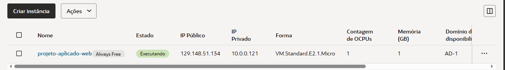</a> | <a href="evidencias/04-security-list.png">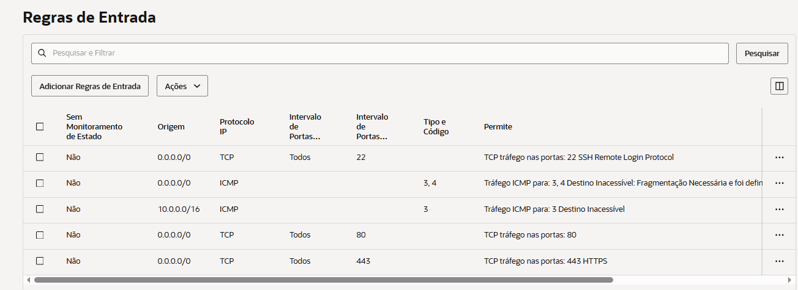</a> |

- **01:** Comprova: a VM foi criada na Oracle Cloud, em execução, com IP público.
- **04:** Comprova: a Security List da VCN permite entrada só em TCP 22, 80 e 443 e ICMP (tipos 3 e 4). Não comprova o firewall do servidor (evidência 03).

## Servidor

| Sistema e Nginx | SSH e firewall | Fail2Ban | Certbot | Serviço do app |
|---|---|---|---|---|
| <a href="evidencias/02-sistema-nginx.png">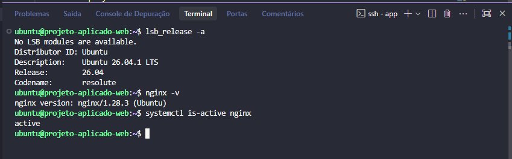</a> | <a href="evidencias/03-ssh-firewall.png">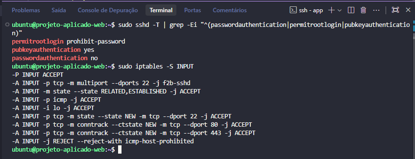</a> | <a href="evidencias/06-fail2ban.png">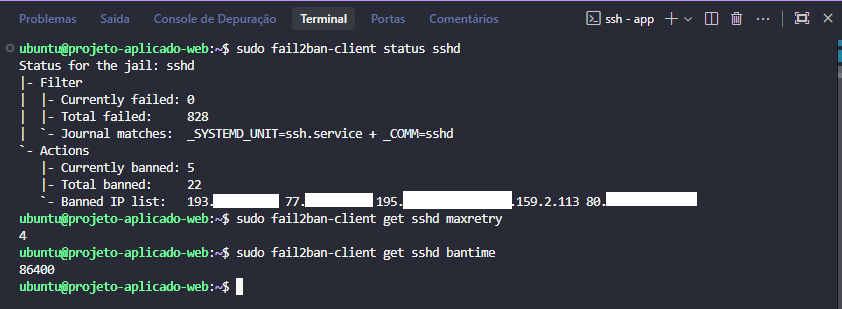</a> | <a href="evidencias/10-certbot-renovacao.png">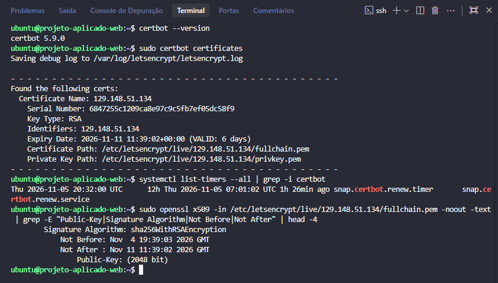</a> | <a href="evidencias/41-servico-appweb.png">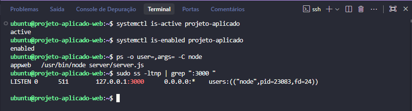</a> |

- **02:** Comprova: Ubuntu 26.04.1 LTS com Nginx 1.28.3 ativo.
- **03:** Comprova: login por senha desligado e só as portas 22, 80 e 443 liberadas, com regra final de rejeição. Não comprova a Security List (evidência 04).
- **06:** Comprova: jail sshd ativa, 4 tentativas, banimento de 24 h e ataques reais já barrados (828 falhas, 22 IPs banidos). Não comprova o banimento do próprio avaliador.
- **10:** Comprova: Certbot 5.9.0, certificado RSA para o IP, emitido em 04/11/2026 (16:39 em Brasília) e válido até 11/11, e timer de renovação agendado. Não comprova a próxima renovação.
- **41:** Comprova: o app roda como serviço ativo e habilitado no boot, com a conta appweb, escutando só em 127.0.0.1:3000.

## HTTPS e TLS

| Redirecionamento 301 | SSL.org | DigiCert (PQC) | App por IP público |
|---|---|---|---|
| <a href="evidencias/08-redirect-301.png">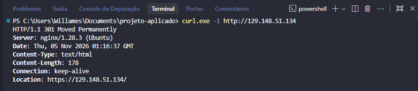</a> | <a href="evidencias/12-ssl-org.png">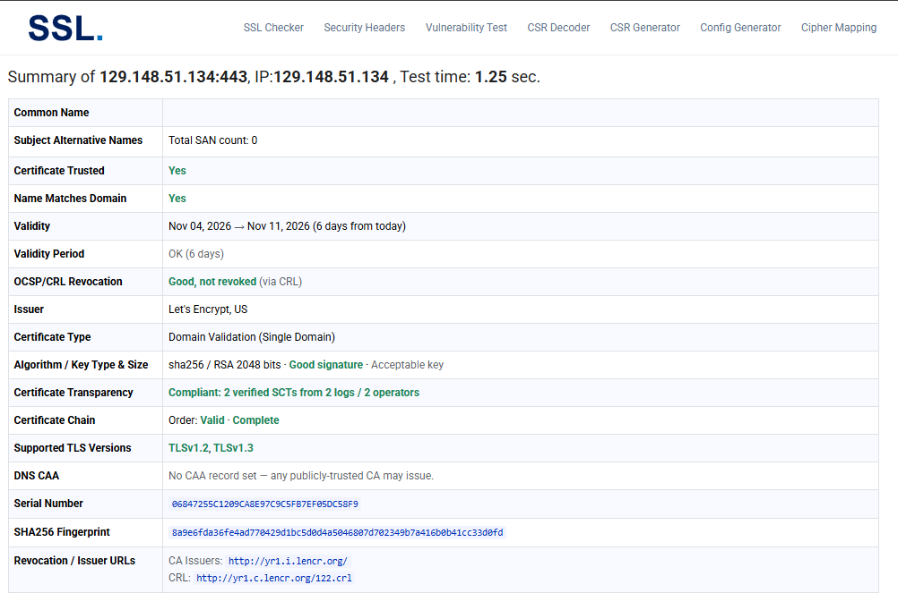</a> | <a href="evidencias/13-digicert-pqc.png">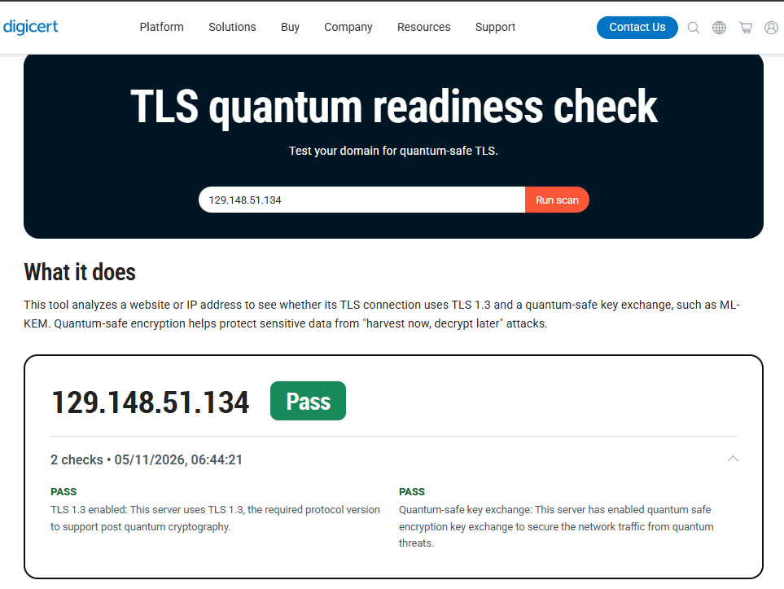</a> |  |

- **08:** Comprova: HTTP responde 301 e redireciona para HTTPS.
- **12:** Comprova: o certificado é confiável (Let's Encrypt), com RSA 2048 e o resultado "Good signature · Acceptable key", TLS 1.2 e 1.3 e validade de 04/11 a 11/11/2026, na data da captura.
- **13:** Comprova: TLS 1.3 habilitado e troca de chaves resistente a computação quântica (os 2 testes em Pass), na data da captura.
- **14:** Comprova: a aplicação está acessível por HTTPS no IP público.

## Repositório e pipeline

| Repositório público | 2FA | Sem segredos | Secrets | Push e Actions |
|---|---|---|---|---|
| <a href="evidencias/17-repo-publico.png">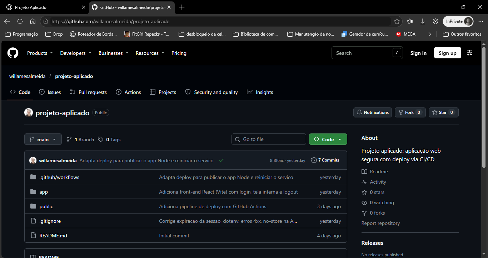</a> | <a href="evidencias/18-github-2fa.png">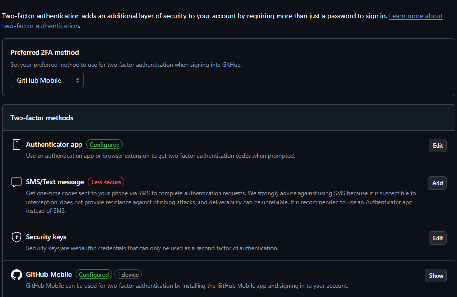</a> | <a href="evidencias/21-sem-segredos.png">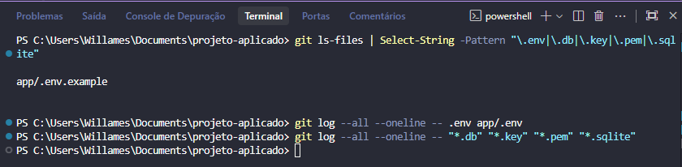</a> | <a href="evidencias/39-secrets.png">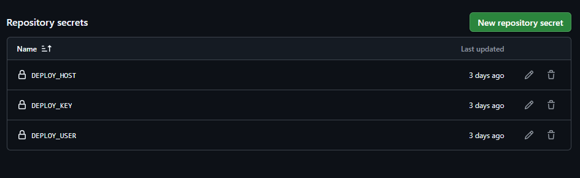</a> | <a href="evidencias/40-push-actions-verde.png">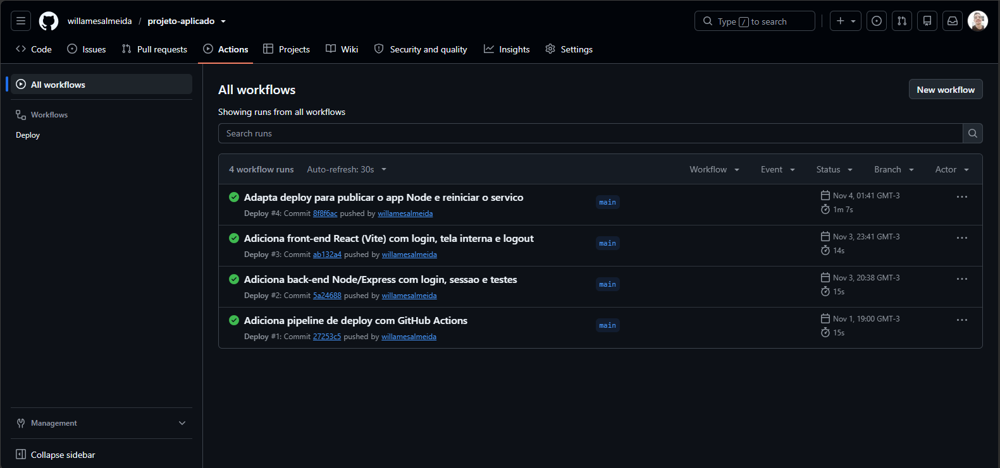</a> |

- **17:** Comprova: o repositório é público.
- **18:** Comprova: a autenticação em dois fatores está ativada na conta do GitHub.
- **21:** Comprova: entre os arquivos versionados só existe o .env.example, e nenhum commit tocou em .env, bancos ou chaves. Não substitui um scanner de segredos.
- **39:** Comprova: as credenciais de deploy estão nos Secrets do GitHub (aparecem só os nomes).
- **40:** Comprova: cada push para a main disparou o workflow Deploy sozinho, e as 4 execuções terminaram em verde.

## Navegador

| Login | Senha errada | Tela interna | Logout | Cookie de sessão | Entrada maliciosa |
|---|---|---|---|---|---|
| <a href="evidencias/26-login.png">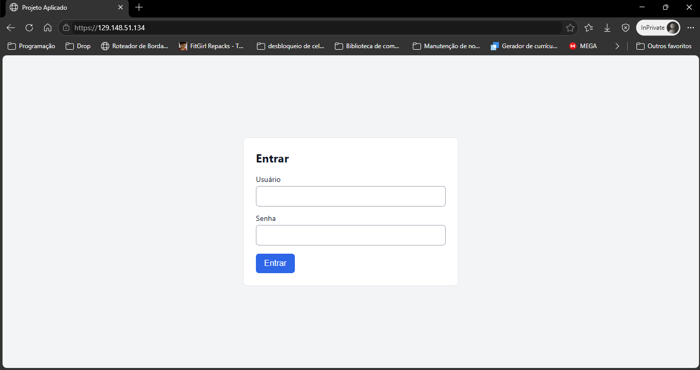</a> | <a href="evidencias/27-senha-errada.png">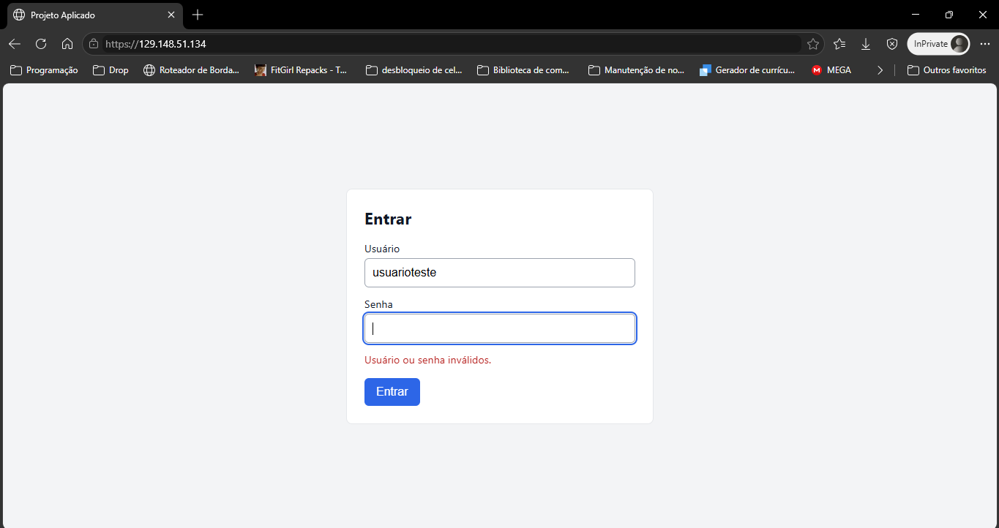</a> | <a href="evidencias/28-tela-interna.png">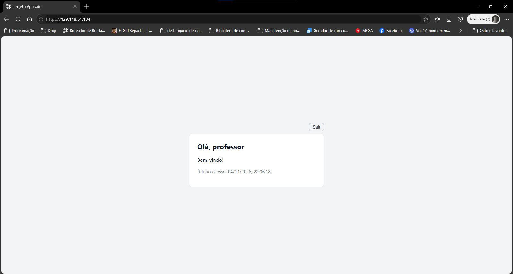</a> | <a href="evidencias/29-logout.png">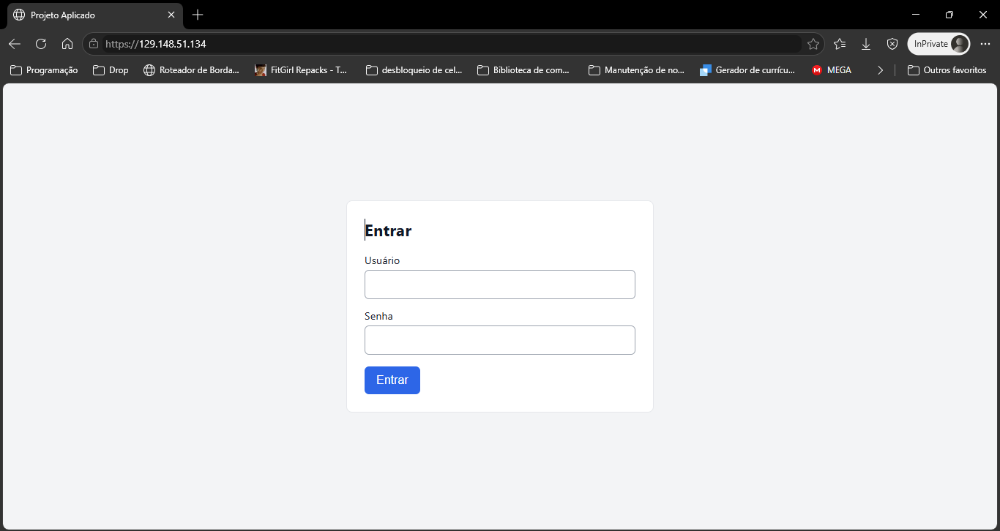</a> | <a href="evidencias/32-cookie-sid.png">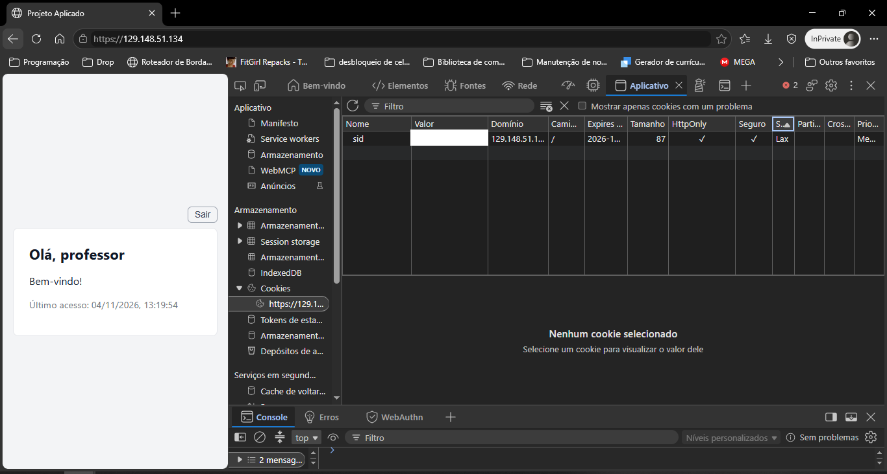</a> | <a href="evidencias/33-sql-injection.png">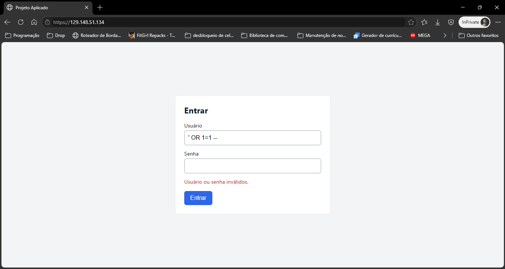</a> |

- **26 a 29:** Comprova: o fluxo em produção (login, mensagem de erro, tela interna e logout). O botão Voltar depois do logout leva à tela de login (resultado relatado, sem print).
- **32:** Comprova: o cookie de sessão tem HttpOnly, Secure e SameSite=Lax. O valor foi coberto.
- **33:** Comprova: um teste de login com entrada de SQL injection, que não resultou em acesso.

## API e testes

| Sem sessão (401) | Erros CSRF, 415, 400 e 404 | npm test | npm audit |
|---|---|---|---|
| <a href="evidencias/31-401-sem-sessao.png">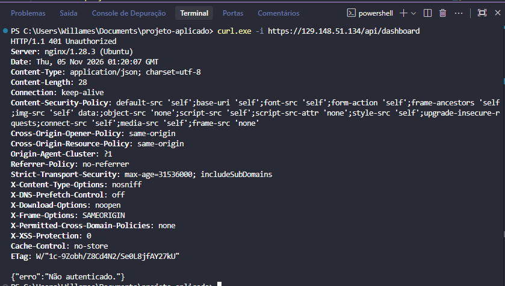</a> | <a href="evidencias/34-erros-csrf-415-400-404.png">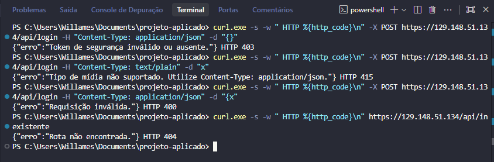</a> | <a href="evidencias/35-npm-test.png">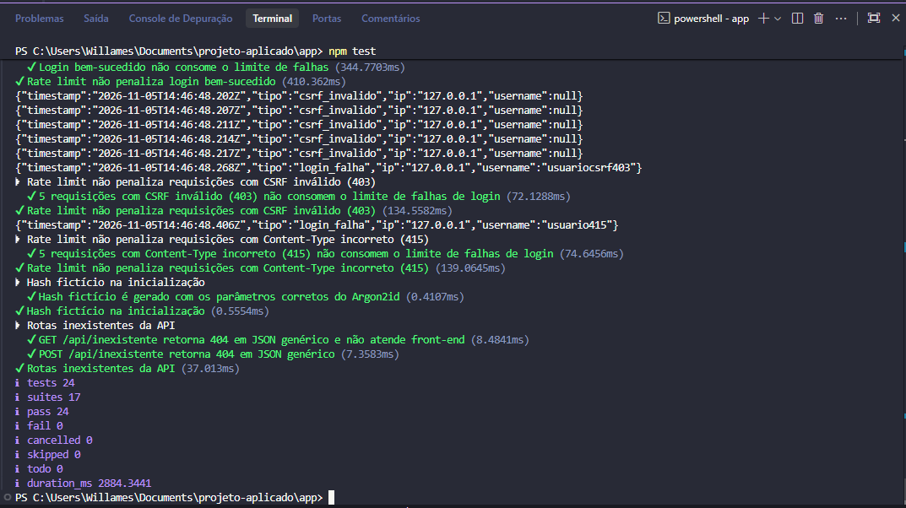</a> | <a href="evidencias/36-npm-audit.png">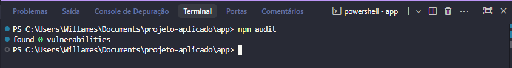</a> |

- **31:** Comprova: a rota /api/dashboard responde 401 sem sessão.
- **34:** Comprova: o servidor rejeita requisições sem token CSRF, com tipo de conteúdo errado, malformadas ou para rotas inexistentes.
- **35:** Comprova: os 24 testes automatizados passam (a pipeline os roda antes de cada deploy).
- **36:** Comprova: o resultado do npm audit na data da captura (0 vulnerabilidades). Não substitui uma auditoria completa.

## Uso de IA

| Antigravity IDE |
|---|
| <a href="evidencias/24-ia-antigravity.png">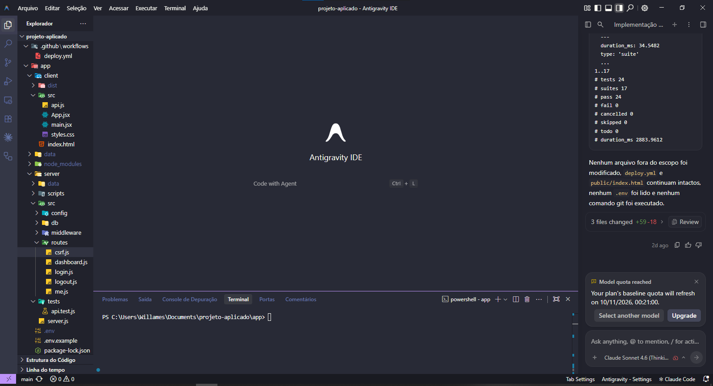</a> |

- **24:** Comprova: o uso de IA dentro do Antigravity IDE, com o modelo Sonnet 4.6 no painel do agente. Não reproduz todo o histórico das conversas.